# EdgeStore Architecture Specification

EdgeStore is an enterprise-grade secure local storage appliance engineered for single-node Raspberry Pi 4 deployment with dual-drive replication (Drive A & Drive B), LUKS2 full-disk encryption, removable physical Key-SD authentication, SHA-256 integrity verification, and battery-aware energy policy.

---

## 1. Overall System Architecture

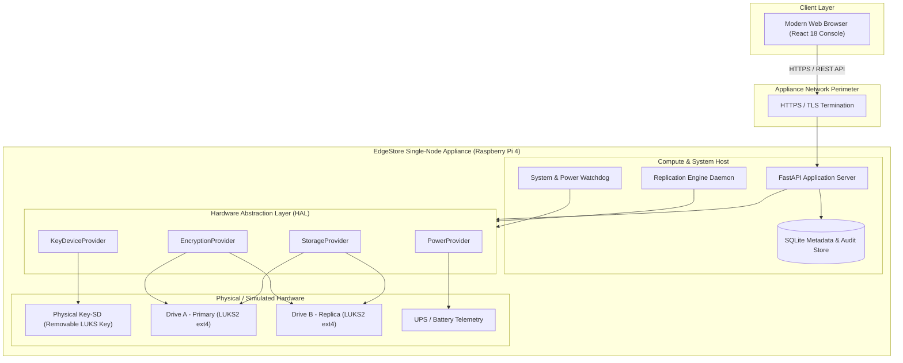

---

## 2. Hardware Architecture

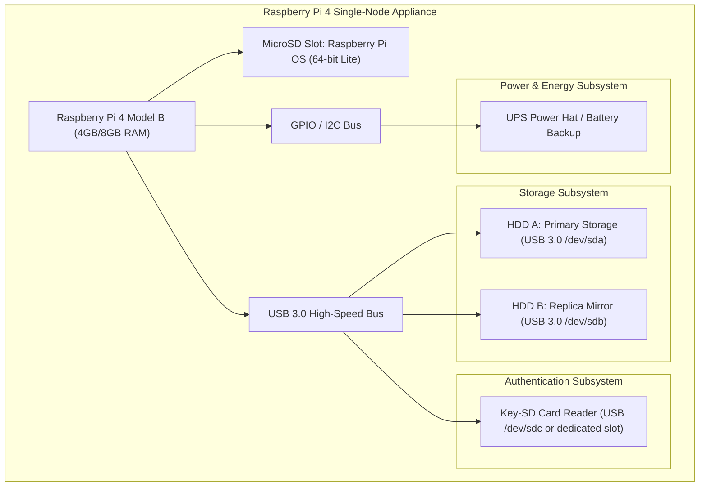

---

## 3. Software Architecture

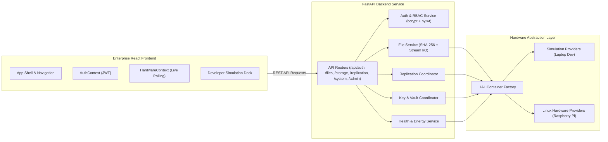

---

## 4. Layered Architecture

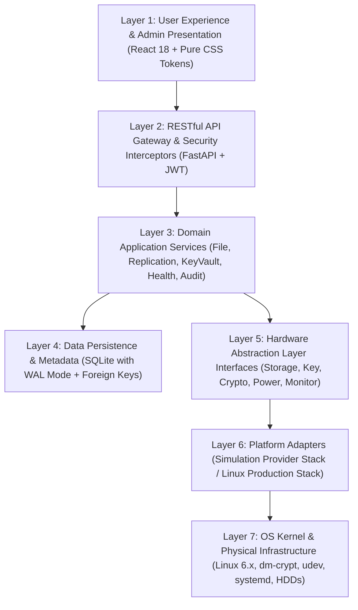

---

## 5. Security Architecture (Defense-in-Depth)

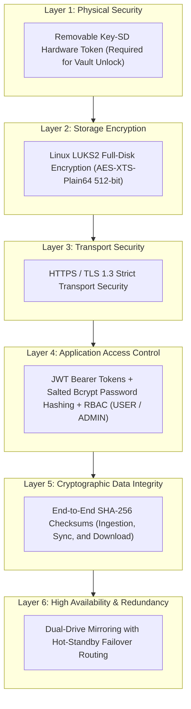

---

## 6. Storage Architecture

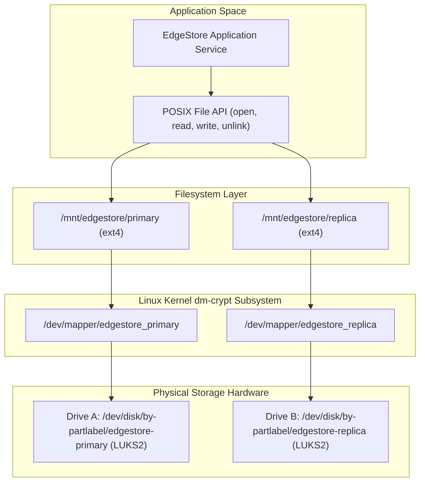

---

## 7. Authentication Flow

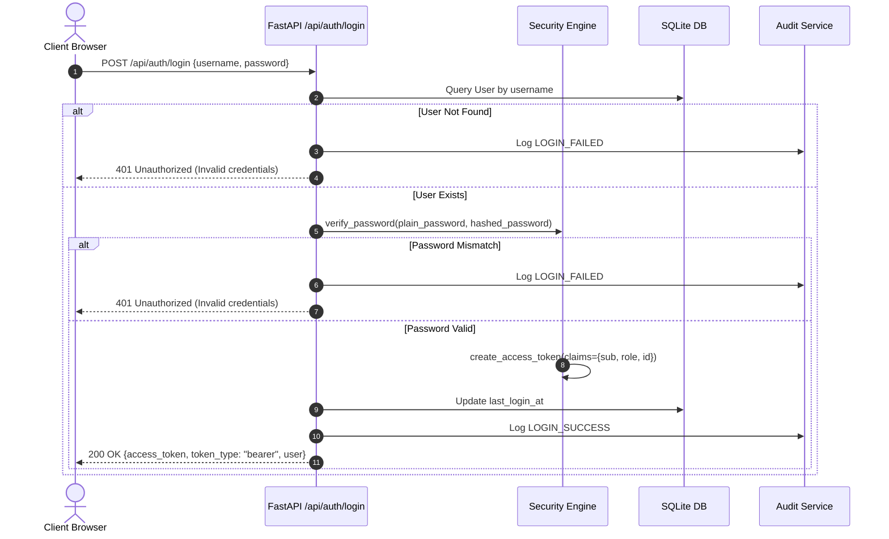

---

## 8. Key-SD Unlock Flow

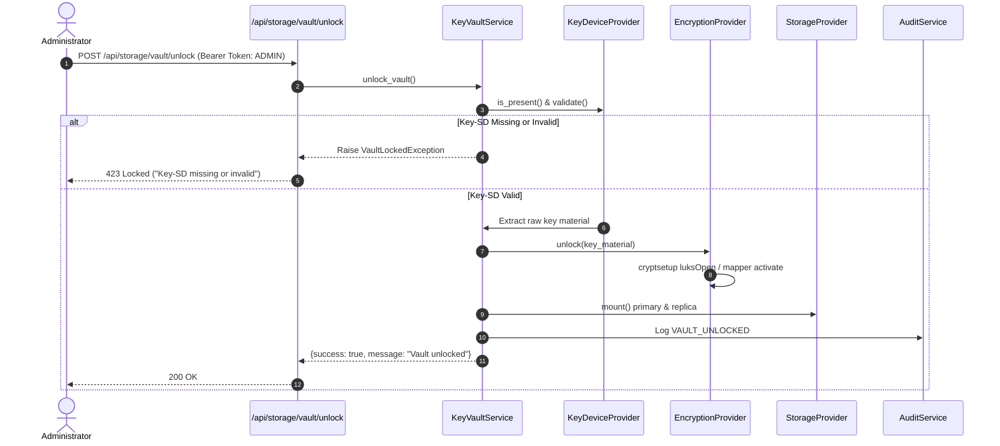

---

## 9. Key-SD Removal Flow

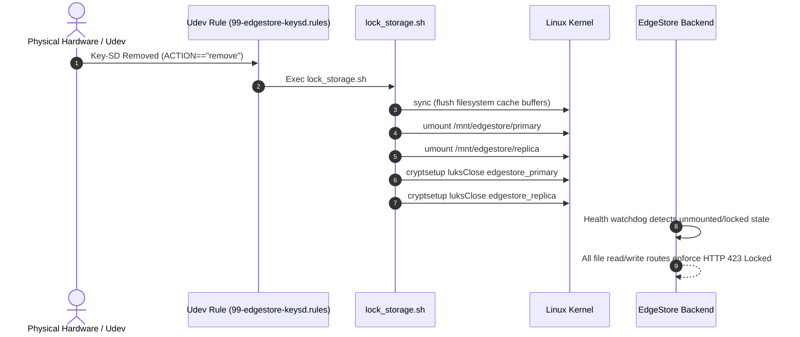

---

## 10. File Upload Flow

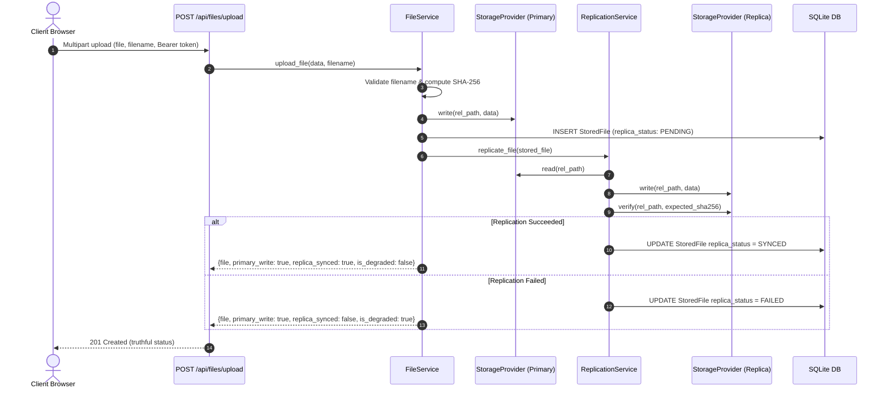

---

## 11. File Download Flow

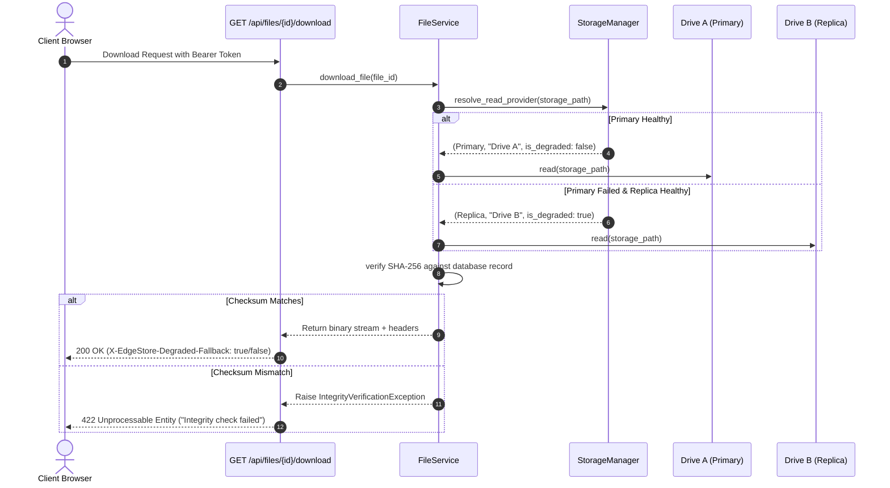

---

## 12. Replication Flow

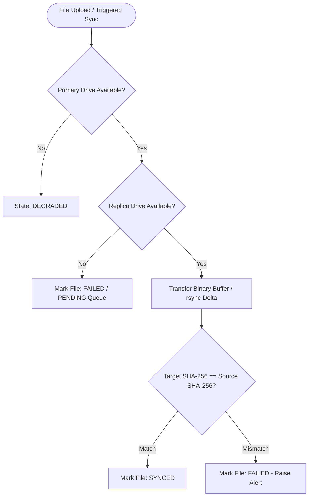

---

## 13. Failure Recovery Flow (Semi-Automated Rebuild)

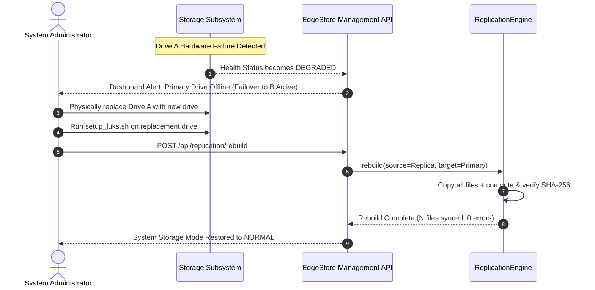

---

## 14. Database ER Diagram

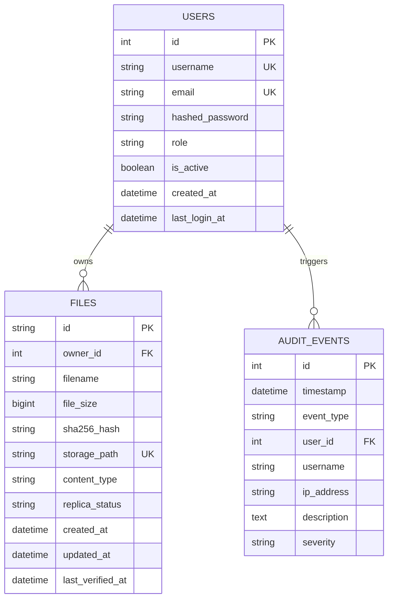

---

## 15. API Architecture

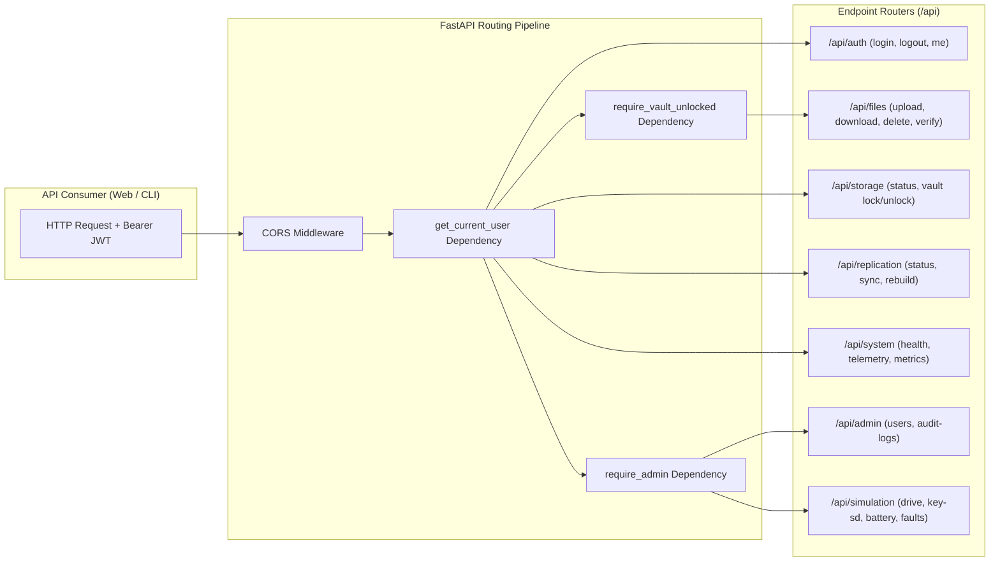

---

## 16. Linux Boot Flow

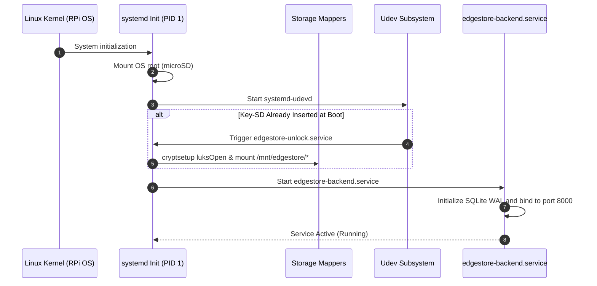

---

## 17. systemd / udev Interaction

```mermaid
graph TD
    KernelBlock["Linux Kernel Block Subsystem"] -->|Hotplug Add/Remove Event| UdevDaemon["systemd-udevd"]
    UdevDaemon -->|Rule: ENV{ID_FS_UUID}=='EDGESTORE-KEY-01'| RuleMatch{"Match Event"}
    RuleMatch -->|ACTION=='add'| StartUnlock["systemctl start edgestore-unlock.service"]
    RuleMatch -->|ACTION=='remove'| StartLock["systemctl start edgestore-lock.service"]
    StartUnlock --> ScriptUnlock["/opt/edgestore/linux/scripts/unlock_storage.sh"]
    StartLock --> ScriptLock["/opt/edgestore/linux/scripts/lock_storage.sh"]
    ScriptUnlock --> MountFilesystems["Mount Ext4 to /mnt/edgestore/primary & replica"]
    ScriptLock --> UnmountFilesystems["Sync & Umount & cryptsetup luksClose"]
```

---

## 18. Simulation-to-Hardware Architecture

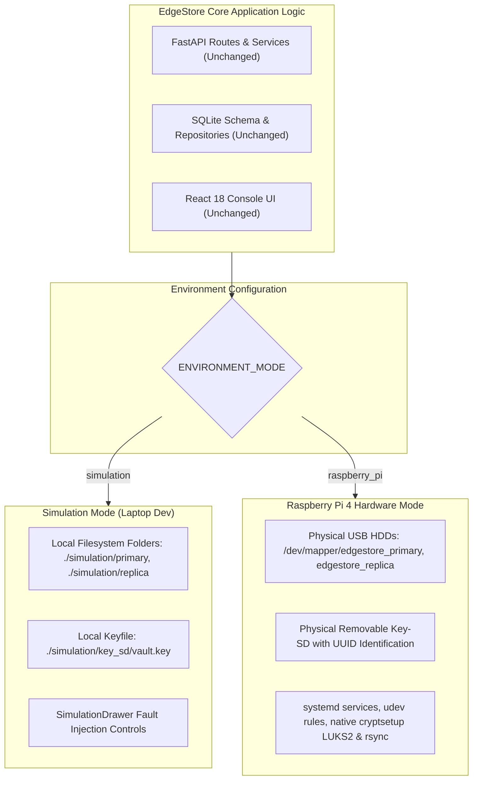
